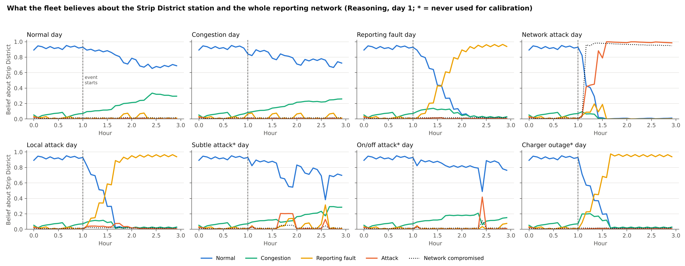

# Can an electric taxi fleet tell when charging data is lying?

**Hierarchical multi-hypothesis reasoning and verification-aware charging decisions under unreliable charger information**

*Syeda Tamzida Akter · prototype, November 2026*

Electric taxi fleets choose where to charge using availability data reported by the charging
network (e.g. over OCPP). If that data is wrong, the fleet can be sent to full stations and lose
vehicle time. Wrong data does not always mean an attack: a station can be busy, its reporting can
fail, one station can be tampered with, or the shared reporting system itself can be compromised.
This prototype asks the fleet to reason about **why** reports disagree with what its taxis
find, at the level of each station **and** of the shared network, and to charge sensibly
**before it knows whether an attack is happening**.



*The fleet's belief about one station (coloured lines) and about the whole reporting network
(dotted line) on five kinds of day. It labels the stale report as a fault, treats the
network-wide lie as a compromised network, and keeps the network belief low when only one
station lies.*

## Motivation

METS-R's charging-security demonstrations (`METS-R_HPC/tutorials/security_demos`, demos 4 and 5)
show the operational cost of charger attacks for an e-taxi fleet, using simulator-free fleet
models. Apart from a fixed timeout-and-reroute fallback, they do not address how a fleet can
**recognize** unreliable charging information and **decide resiliently** without knowing whether
an attack is occurring. The 2025 TraCR testbed report also lists charging/energy attacks and
robust anomaly detection as open work.

## Idea: the fleet is its own sensor

Every taxi that arrives at a station sees the truth: free plugs and the line. Comparing that with
the report gives evidence. The report stream itself is also evidence: whether it changes, and
whether it shows implausible values. Instead of one alarm, the fleet weighs explanations.

**At each station j:**

| | Explanation | What it predicts |
|---|---|---|
| **N** | Normal | Reports accurate; small mismatches when a plug is taken while a taxi drives there |
| **C** | Congestion | Reports accurate, but the station is busy and changes fast |
| **F** | Reporting fault | Report stale or frozen |
| **A** | Attack | Reports falsified ("all plugs free" while a line waits, or "jammed" while plugs are free); values stop changing |

**For the shared reporting network:** $G \in \{0, 1\}$, i.e. is the charging management system
that all stations report through compromised? A compromised network makes several stations
lie at once. A fault or a single tampered station does not.

## Method

All code for the method is in [`reasoning/`](reasoning/) and does not depend on any simulator.

**1. Hierarchical Bayesian filter** ([`network.py`](reasoning/network.py)). The fleet tracks the
exact joint belief over the network state and every station's explanation,
$b(G, H_1, \dots, H_J)$ (2 × 4⁴ = 512 states for 4 stations):

$$b_t(G, H) \propto P(o_t \mid H)\sum_{G', H'} P(G \mid G')\prod_j P(H_j \mid H'_j, G)\; b_{t-1}(G', H')$$

If $G = 0$, an attack at a single station is rare but possible. If $G = 1$, stations are likely
to move into A. Evidence at one station therefore changes the belief about $G$, and through $G$
about every other station. Honest-looking evidence elsewhere pushes back, so one lying station
can also be explained as a local attack.

**2. Observations** ([`hypotheses.py`](reasoning/hypotheses.py)):
- on each taxi arrival (or verification): the discrepancy $D$ = reported − observed availability
  (availability = free plugs − waiting vehicles; bins $D \le 0$, $1$, $\ge 2$), and whether the
  report was an extreme value;
- every 10 minutes, for every station, even if no taxi visits: did the report change, and is it
  "jammed" (no plug free, 3 or more waiting)? This never occurred in 192 normal reports.

Likelihood tables are explicit in the code. The normal row and the change rates are
**calibrated on simulated days not used for testing** ([`experiments/calibrate.py`](experiments/calibrate.py));
the other entries are stated assumptions.

**3. "None of my explanations fits."** The predictive probability
$P(o_t \mid \text{history}) = \sum_k P(o_t \mid k)\, b_t(k)$ is tracked as an exponentially
weighted average of $-\log P$. If it stays high, the fleet treats that station conservatively.

**4. Decisions over explanations** ([`controllers.py`](reasoning/controllers.py)). For each
station, the expected wait is averaged over explanations: reported availability under N/C, and
the fleet's own estimate plus a penalty under F/A. Then:
- **battery-aware risk:** a nearly empty taxi also pays for the worst-case explanation;
- **hedging:** at most 2 taxis at once to a probably unreliable station;
- **verify or go:** if the expected value of perfect information about the best station,
  $\text{EVPI} = \min_a \sum_k b(k)L(a,k) - \sum_k b(k)\min_a L(a,k)$, exceeds the cost of checking
  (the taxi waits 3 min), the fleet verifies first.

**Controllers compared**

| Controller | Detection | Decision rule |
|---|---|---|
| `TrustAll` | none | use reports as is |
| `CUSUM` | change detection on mismatches; after the alarm, trust no station | same cost as TrustAll |
| `CUSUM+` | CUSUM | **the same decision rule as Reasoning**, so we can separate reasoning from decision-making |
| `Reasoning-Indep` | multi-hypothesis filter per station, no network state | Reasoning rule |
| `Reasoning` | hierarchical (network + station) filter | Reasoning rule |

## Test scenario

A small SUMO model of Oakland, the Strip District, Lawrenceville and Bloomfield (Pittsburgh,
OpenStreetMap): 40 e-taxis (30 kWh, 0.2 kWh/km), 120 ride requests/hour, 4 stations with 3 fast
chargers (50 kW), public EVs using plugs, random background traffic. A Python (TraCI) controller
plays the fleet operator, in the same way METS-R's control API is used. From hour 1 of each
3-hour day:

| Day | What happens | Reports |
|---|---|---|
| normal | nothing | accurate |
| congestion | at Strip District, public EVs come and go every 3 min | accurate, but can be out of date on arrival |
| fault | the Strip District report freezes | stale |
| network attack | Strip District shown "all free"; every other station shown "full, 4 waiting" | falsified everywhere |
| local attack | only Strip District shown "all free" | falsified at one station |

5 day types × 5 controllers × 6 test days = 150 runs, each a full 3-hour SUMO simulation.

## Results


Means over 6 days (full table: [`results/summary_table.md`](results/summary_table.md)).
"Honest stations distrusted" = stations reporting truthfully that the controller stopped using.

| Day | Controller | Taxi-hours in charger lines (mean ± sd) | Attack alarms | Time to detect (min) | Honest stations distrusted | Diagnosis at Strip District |
|---|---|---|---|---|---|---|
| network attack | TrustAll | 7.64 ± 3.66 | 0/6 | – | – | – |
| | CUSUM | **0.34 ± 0.20** | 6/6 | 13.6 | – | – |
| | CUSUM+ | 0.39 ± 0.19 | 6/6 | 13.6 | – | – |
| | Reasoning-Indep | 0.63 ± 0.33 | 6/6 | **8.8** | – | A×6 |
| | Reasoning | 0.44 ± 0.25 | 6/6 | **8.8** | – | A×6 |
| local attack | CUSUM / CUSUM+ | 0.19 ± 0.26 | 6/6 | 47 | **3 of 3** | – |
| | Reasoning | 0.20 ± 0.26 | 3/6 | 19 | **0 of 3** | A×1, F×5 |
| reporting fault | CUSUM / CUSUM+ | 0.13 ± 0.26 | **2/6 (false)** | – | 3 of 3 on those days | – |
| | Reasoning | 0.16 ± 0.24 | **0/6** | – | 0 | **F×6** |
| congestion | CUSUM | 1.85 ± 2.04 | 0/6 | – | 0 | – |
| | Reasoning | 1.60 ± 1.98 | 0/6 | – | 0 | N×5, C×1 |
| normal | all | 0.13–0.15 | 0/6 | – | 0 | N×6 |

**What the results show**
1. **Sharing evidence across the network matters.** Under a network-wide attack, the hierarchical
   filter lost 0.44 taxi-hours versus 0.63 for the same reasoning per station. A first version of
   this prototype (station-by-station, without report-stream evidence) lost 1.0 taxi-hours,
   because it kept believing the other stations' false "full" reports
   ([`results/old_v1`](results/old_v1/summary_table.md); 4-hour days and 3 test days, so not directly comparable).
2. **It detected the network attack faster:** 8.8 vs 13.6 min for CUSUM, on all 6 days.
3. **It doesn't over-react.** On reporting-fault days, CUSUM raised a false attack alarm on 2 of 6
   days and then ignored all four stations. The reasoning controller raised none and diagnosed a
   fault all 6 times. In a local attack, CUSUM threw away the data of 3 honest stations (after 47
   min); the reasoning controller kept trusting them while avoiding the lying one.
4. **CUSUM+ ≈ CUSUM**, so the decision rule alone doesn't explain the differences; the reasoning does.

**Where it did not win**
- **Fleet time lost is about the same as CUSUM** in every scenario. Under the network attack,
  CUSUM is still slightly better (0.34 vs 0.44); the difference is within one standard deviation,
  so 6 days cannot separate them. In this setup the fleet's own estimate of a station is almost
  as good as an honest report, so distrusting honest stations (CUSUM's mistake) costs little.
  A test where honest reports are clearly more informative than the fleet's own view (many public
  EVs, larger area) is needed to show whether "not over-reacting" saves fleet time.
- **Local attack vs fault at one station isn't separable here.** A frozen "all free" report looks
  the same whether it's malicious or stale, unless taxis go there. The controller labelled 5 of 6
  local attacks as faults. Both labels lead to the same action (stop trusting that station), but
  the diagnosis itself is not reliable for this case.
- Congestion differences are small compared with the day-to-day spread.

## Limitations

- **Small study:** 6 test days per case, one city area, one target station, events at a fixed time.
- **Assumed numbers:** fleet, battery and charger values, the C/F/A likelihoods and the network
  transition probabilities (only the normal row and change rates are calibrated). Results depend
  on them.
- **Simple attackers:** fixed lies. They don't adapt to the detector or stay below its threshold.
- **Simplified world:** random demand and background traffic (not calibrated to Pittsburgh),
  simple public-EV model, stations tracked in Python rather than modelled physically,
  verification modelled as a 3-minute delay. It was **never triggered** in these 150 runs, so the
  value-of-information part is implemented but untested here.

## Next steps

1. A scenario where honest reports are worth more than the fleet's own estimate, to test whether
   avoiding over-reaction saves fleet time.
2. An adaptive, stealthy attacker that tries to stay below the detector.
3. 30+ days per case with confidence intervals, other target stations and attack times.
4. **Run the same `reasoning/` module in METS-R**, building on the pattern of the security
   notebook's "Attack 5: Charging-Price Spoofing":

| This prototype (SUMO + TraCI) | METS-R API |
|---|---|
| Reported availability per station | `query_chargingStation(id)` → `availableLevel3ChargerCount` |
| Python decides where to charge | config `"charging_controlled_by_control_apis": true` |
| Send taxi to station *j* | `go_charging(vehID, False, 1, cs_id=j)` |
| Taxi battery | `query_available_taxis()` / `query_vehicle()` → `battery` |
| Taxi state | `query_taxi(id)` → `state` |
| Attack layer | falsify the `query_chargingStation` result before the controller sees it |

## Run it

Requires Python 3.10+ and SUMO (`pip install -r requirements.txt` installs SUMO).

```
python sim/etaxi_env.py --scenario attack --controller Reasoning --seed 1          # one 3-hour day (a few minutes)
python sim/etaxi_env.py --scenario local_attack --controller Reasoning --gui      # watch it in sumo-gui
python experiments/run_experiments.py --seeds 1 2 3 4 5 6 --workers 3              # all 150 runs
python experiments/summarize.py
python experiments/make_figures.py
```

## Repository

```
reasoning/        the method (simulator-independent)
  hypotheses.py     station explanations, likelihood tables, independent filter
  network.py        hierarchical filter over network compromise + station explanations
  controllers.py    Reasoning, Reasoning-Indep, and the TrustAll / CUSUM / CUSUM+ / Threshold baselines
sim/              small SUMO test scenario (Pittsburgh) and network
experiments/      calibration, batch runs, summary, figures
results/          summaries, belief traces, time series, figures; old_v1 = first version's results
```

The per-run logs (summaries, belief traces, time series for all 150 runs) are packed in
`results/runs.zip`. Unzip it inside `results/` before running `summarize.py` or `make_figures.py`.


