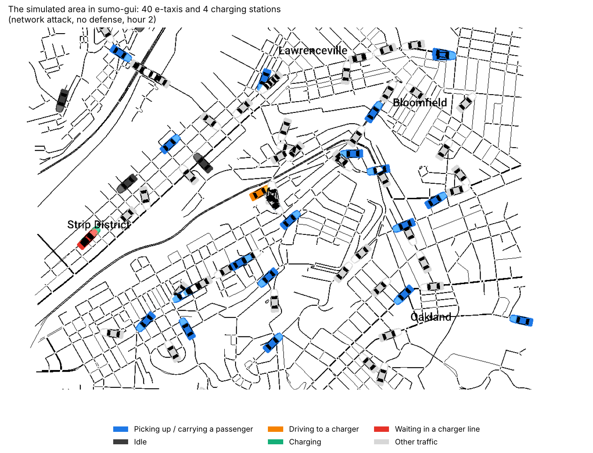
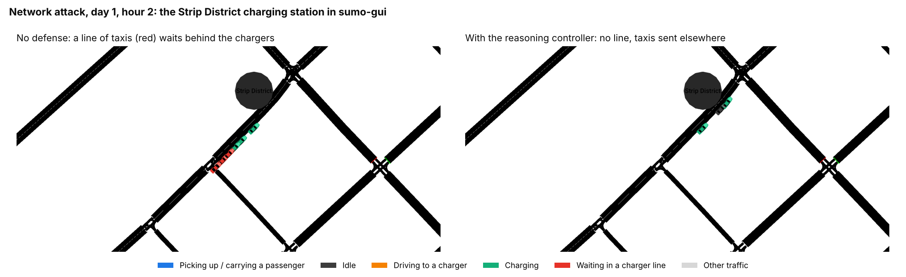
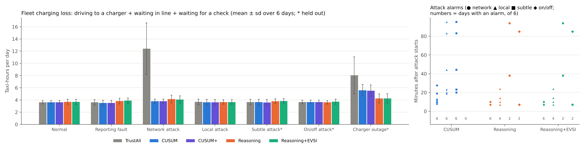
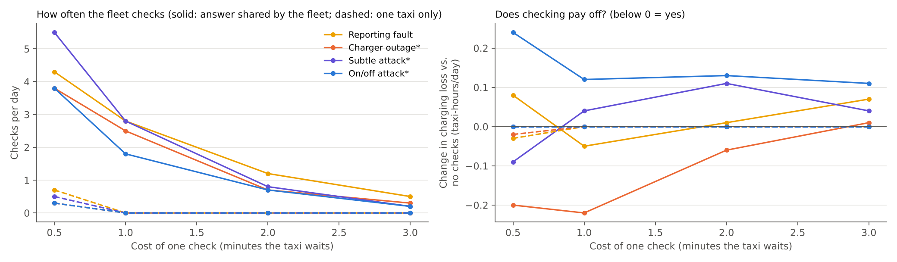

# Can an electric taxi fleet tell when charging data is lying?

**Hierarchical multi-hypothesis reasoning and decision-aware verification for charging under unreliable charger information**

*Syeda Tamzida Akter · prototype, November 2026 (version 3)*

Electric taxi fleets choose where to charge using availability data reported by the charging
network (e.g. over OCPP). If that data is wrong, the fleet can be sent to full stations and lose
vehicle time. Wrong data does not always mean an attack: a station can be busy, its reporting can
fail, its chargers can break, one station can be tampered with, or the shared reporting system
itself can be compromised. This prototype asks the fleet to reason about **why** reports disagree
with what its taxis find, at the level of each station **and** of the shared network, to charge
sensibly **before it knows whether an attack is happening**, and to decide **when checking a
station is worth the time**.


*The fleet's belief about one station (coloured lines) and about the whole reporting network
(dotted line) on eight kinds of day. Days marked * were never used to fit the model.*

## What changed in version 3

Version 2 was reviewed; the review's main points and what this version does about them:

| Review point | Change |
|---|---|
| Attack likelihoods were hand-set and matched the tested attack | All four rows are now **fitted on calibration days of the training situations only**; three situations are **held out** (a subtle attack, an on/off attack, a charger outage) |
| Verification was never triggered | Verification now uses the **expected value of sample information (EVSI)** of an *imperfect* check, counted for every taxi that will use the answer, plus a **decision-sensitivity** measure $D_t$; a **verification-cost sweep** tests when checking pays off |
| Queue time alone can hide delay moved elsewhere | Main measure is now **fleet charging loss = driving to a charger + waiting in line + waiting for a check** |
| Small differences vs. day-to-day spread | **Paired differences with 95% confidence intervals** over the same days |

Measuring total loss exposed two problems in version 2's code, both fixed:
mismatches caused by the fleet's own taxis arriving at a station together were counted as
evidence against the report (this produced false alarms at the start of the day), and the risk term
charged every station the wait of its worst explanation even when that explanation was very
unlikely (it is now the belief-weighted standard deviation). Version 2's results are kept in
`results/old_v2_*`.

## Motivation

METS-R's charging-security demonstrations (`METS-R_HPC/tutorials/security_demos`, demos 4 and 5)
show the operational cost of charger attacks for an e-taxi fleet, using simulator-free fleet
models. Apart from a fixed timeout-and-reroute fallback, they do not address how a fleet can
**recognize** unreliable charging information and **decide resiliently** without knowing whether
an attack is occurring. The 2025 TraCR testbed report also lists charging/energy attacks and
robust anomaly detection as open work.

## Idea: the fleet is its own sensor

Every taxi that arrives at a station sees the truth: free plugs and the line. Comparing that with
the report gives evidence. The report stream itself is also evidence: whether it changes, and
whether it shows implausible values. Instead of one alarm, the fleet weighs explanations.

**At each station j:**

| | Explanation | What it predicts | Wait the fleet expects |
|---|---|---|---|
| **N** | Normal | Reports accurate | from the report |
| **C** | Congestion | Reports accurate, but the station is busy and changes fast | from the report + margin |
| **F** | Fault | Report stale or frozen; the equipment may be partly down | own estimate, with some plugs possibly broken |
| **A** | Attack | Reports falsified | own estimate |

**For the shared reporting network:** $G \in \{0, 1\}$, i.e. is the charging management system
that all stations report through compromised? A compromised network makes several stations
lie at once. A fault or a single tampered station does not.

## Method

All code for the method is in [`reasoning/`](reasoning/) and does not depend on any simulator.

**1. Hierarchical Bayesian filter** ([`network.py`](reasoning/network.py)). The exact joint belief
over the network state and every station's explanation, $b(G, H_1, \dots, H_J)$
(2 × 4⁴ = 512 states for 4 stations):

```math
b_t(G, H) \propto P(o_t \mid H)\sum_{G', H'} P(G \mid G')\prod_j P(H_j \mid H'_j, G)\; b_{t-1}(G', H')
```

Evidence at one station changes the belief about $G$, and through $G$ about every other station.

**2. Observations** ([`hypotheses.py`](reasoning/hypotheses.py)): on each taxi arrival, the
discrepancy $D$ = reported − observed availability (bins $D \le 0$, $1$, $\ge 2$; fleet taxis that
arrived since the report was issued are subtracted) and whether the report was extreme; every
10 minutes, whether each report changed and whether it is "jammed".

**3. Calibration on training situations only** ([`calibrate.py`](experiments/calibrate.py)).
Each likelihood is estimated from simulated calibration days (seeds 101–102, never used for
testing), shrunk towards the hand-set value with 5 pseudo-observations:
N from normal days, C from congestion, F from report-fault days, A from the two "all plugs free"
attacks. The fitted tables are in [`reasoning/likelihoods.json`](reasoning/likelihoods.json).

| | P(D≤0) | P(D=1) | P(D≥2) | P(extreme report) | P(jammed) | P(report changed) |
|---|---|---|---|---|---|---|
| N | 0.98 | 0.01 | 0.01 | 0.29 | 0.01 | 0.66 |
| C | 0.90 | 0.08 | 0.03 | 0.05 | 0.01 | 0.60 |
| F | 0.62 | 0.23 | 0.15 | 0.10 | 0.01 | 0.01 |
| A | 0.17 | 0.09 | 0.74 | 0.99 | 0.60 | 0.01 |

The fitted attack row is a sharp "signature" (extreme, frozen reports): exactly the risk the
review raised. The held-out attacks test it.

**4. Decisions over explanations** ([`controllers.py`](reasoning/controllers.py)). Expected
travel + wait, averaged over explanations; a battery-aware risk term
($\lambda(\text{SOC})\times$ standard deviation of the wait under the belief); at most 2 taxis at once
to a probably unreliable station; conservative waits if no explanation fits (high surprise).

**5. Decision-aware verification (`Reasoning+EVSI`).** A check of station $j$ (a call, a camera,
a fleet vehicle nearby) returns an *imperfect* observation $Y$: right with probability 0.8,
otherwise uninformative, so $P(Y=y \mid k) = 0.8 \cdot P(D=y \mid k) + 0.2/3$. With $L(a,k)$ the cost of
choosing station $a$ if $j$'s explanation is $k$:

```math
\mathrm{EVSI}_j = \min_a \sum_k b_j(k)L(a,k) \;-\; \sum_y P(y)\,\min_a \sum_k b_j(k\mid y)\,L(a,k)
```

The answer is a shared good: every taxi that decides before the next check of $j$ can use it. With
$r$ the fleet's recent rate of charging decisions and $\tau = 15$ min the lifetime of an answer,
the fleet checks the station with the largest $\mathrm{EVSI}_j(1 + r\tau)$ if it exceeds the cost of
the check (the taxi waits $c$ minutes). The **decision sensitivity**

```math
D_j = 1 - \max_a \sum_k b_j(k)\,\mathbb{1}[a = a^{\ast}(k)], \qquad a^{\ast}(k) = \arg\min_a L(a,k)
```

is 0 when every explanation leads to the same choice; then checking cannot change the decision
and is skipped. `Reasoning+EVSI-solo` (ablation) counts EVSI for the deciding taxi only, i.e.
the review's formula as written.

**Controllers compared**

| Controller | Detection | Decision rule |
|---|---|---|
| `TrustAll` | none | use reports as is |
| `CUSUM` | change detection on mismatches; after the alarm, trust no station | same cost as TrustAll |
| `CUSUM+` | CUSUM | **the same decision rule as Reasoning** |
| `Reasoning` | hierarchical filter | expected cost over explanations; one-taxi EVPI check (never fires) |
| `Reasoning+EVSI` | hierarchical filter | same + decision-aware verification |

## Test scenario

A small SUMO model of Oakland, the Strip District, Lawrenceville and Bloomfield (Pittsburgh,
OpenStreetMap): 40 e-taxis (30 kWh, 0.2 kWh/km), 120 ride requests/hour, 4 stations with 3 fast
chargers (50 kW), public EVs using plugs, random background traffic. A Python (TraCI) controller
plays the fleet operator, in the same way METS-R's control API is used. From hour 1 of each
3-hour day:

| Day | What happens at the Strip District station (unless stated) | Used to fit the model? |
|---|---|---|
| normal | nothing | yes |
| congestion | public EVs come and go every 3 min | yes |
| fault | the report freezes (stale data, chargers fine) | yes |
| network attack | shown "all free"; every other station shown "full, 4 waiting" | yes |
| local attack | shown "all free" | yes |
| **subtle attack*** | shown one more free plug than real, one waiting vehicle hidden; keeps changing | **no** |
| **on/off attack*** | alternates every 10 min between the truth and "all free" | **no** |
| **charger outage*** | 2 of 3 plugs break; the report freezes at "2 free, no line" | **no** |

8 day types × 5 controllers × 6 test days = 240 runs, plus 168 runs for the verification sweep,
each a full 3-hour SUMO simulation.

## What it looks like in SUMO



The close-up below is the Strip District station at the same moment of the same attack day, once
with no defense and once with the reasoning controller (screenshots made with version 2). Without
a defense, taxis believe the fake "all chargers free" report and line up behind the 3 chargers
(red). The reasoning controller sends them to the other stations instead.



Note: in these screenshots, taxis in line are parked a few meters apart so the line is visible.
This changes only where they stop, not the results. To regenerate:
`python experiments/make_screenshots.py --scenario attack --controller TrustAll --at 2.0`
(and `--controller Reasoning`), then `python experiments/compose_sumo_figure.py`.

## Results



Fleet charging loss in taxi-hours per 3-hour day, mean over 6 days (full tables:
[`results/summary_table.md`](results/summary_table.md)). The last column is the paired difference
Reasoning − CUSUM on the same days with its 95% confidence interval; negative = Reasoning loses less.

| Day | TrustAll | CUSUM | CUSUM+ | Reasoning | Reasoning+EVSI | Reasoning − CUSUM |
|---|---|---|---|---|---|---|
| normal | 3.60 | 3.60 | 3.60 | 3.68 | 3.68 | +0.07 [−0.20, 0.35] |
| congestion | 5.35 | 5.35 | 5.35 | 5.03 | 4.92 | −0.32 [−2.39, 1.75] |
| fault | 3.60 | 3.52 | 3.52 | 3.81 | 3.88 | +0.29 [−0.19, 0.77] |
| network attack | 12.39 | **3.79** | 3.78 | 4.15 | 4.07 | +0.37 [−0.22, 0.96] |
| local attack | 3.69 | 3.62 | 3.61 | 3.66 | 3.66 | +0.04 [−0.28, 0.36] |
| subtle attack* | 3.65 | 3.66 | 3.58 | 3.80 | 3.83 | +0.14 [−0.48, 0.76] |
| on/off attack* | 3.66 | 3.66 | 3.66 | 3.61 | 3.72 | −0.05 [−0.20, 0.10] |
| **charger outage*** | 8.03 | 5.58 | 5.50 | **4.24** | 4.26 | **−1.34 [−2.10, −0.57]**, 6 of 6 days |

| Day | Attack alarms (days of 6), mean minutes to alarm | Honest stations distrusted | Reasoning's diagnosis at Strip District |
|---|---|---|---|
| fault | CUSUM 2 (false); Reasoning 1 (false) | CUSUM 1.0, Reasoning 0.2 | F×6 |
| network attack | CUSUM 6, 14.5 min; Reasoning 6, **9.5 min** | – | A×6 |
| local attack | CUSUM 6, 47.5 min; Reasoning 4, 13.8 min | CUSUM 3, **Reasoning 0.2** | F×6 |
| subtle attack* | CUSUM 6, 47.7 min; Reasoning **2**, 66 min | CUSUM 3, Reasoning 0 | N×4, F×2 |
| on/off attack* | CUSUM **0**; Reasoning 2, 46 min | 0 | N×5, F×1 |
| charger outage* | CUSUM 5 (wrongly "attack"); Reasoning 0 | CUSUM 2.5, Reasoning 0.2 | **F×6** |



**Verification** (sweep over the cost of one check, on the fault, outage and held-out days):
- Counted for one taxi only (the review's formula), a check is almost never worth it: 0.3–0.7
  checks per day at 0.5 min, none at 1 min or more. One taxi's choice rarely depends enough
  on one station, because the other stations are close.
- Counted for every taxi that uses the answer, the fleet checks 4–6 times a day at 0.5 min,
  about 2–3 at 1 min, and less than once at 3 min.
- Effect on loss: in the outage, cheap checks (1 min) lowered loss by 0.22 taxi-hours/day on
  average (5 of 6 days better), but the 95% interval [−0.54, 0.09] includes zero. In the other
  situations the effect is within ±0.25 and not consistent.

### What these results support

Following the review's three levels:

**Supported**
1. **Distinguishing causes pays off when the cause changes the right action.** In the charger
   outage (never used to fit the model), the reasoning controller diagnosed a fault on all 6 days
   and lost 1.34 taxi-hours/day less than CUSUM (95% CI [−2.10, −0.57], better on 6 of 6 days)
   and 3.8 less than no defense. CUSUM called the outage an attack on 5 of 6 days. Its "attack"
   response is to stop trusting reports, which fixes the wrong problem: the station's capacity is
   down, and it was still sending taxis there based on its own estimate.
2. **Faster detection of the network-wide attack** (9.5 vs 14.5 min, 6 of 6 days), and much
   faster detection of the local attack (13.8 vs 47.5 min) without distrusting the honest stations.

**Partly supported**
3. Fewer false attack alarms on fault days (1 of 6 vs 2 of 6; version 2 had 0 of 6), and honest
   stations are kept in use. This has not produced a measurable fleet-time benefit.
4. Fleet-shared EVSI makes verification happen and may help when checks are cheap, but 6 days
   cannot show a benefit.

**Not demonstrated**
5. **Better fleet loss than CUSUM under attacks.** Under the network attack, CUSUM is slightly
   better (3.79 vs 4.15; the interval includes zero). On fault and subtle-attack days, the
   reasoning controller drives a little more; this is not significant but has the same sign.
6. **Transfer to unseen attacks.** The fitted attack row learned the signature of the training
   attacks (extreme, frozen reports). The subtle attack was detected on only 2 of 6 days (labelled
   normal on 4), and the on/off attack on 2 of 6. These attacks did little harm in this setup
   (loss close to a normal day for every controller), so missing them cost little here. The
   diagnosis does not transfer, though: an attack that does cause harm while looking honest
   would not be caught.
7. **Verification improving decisions** at realistic check costs.

## Limitations

- **Small study:** 6 test days per case, one city area, one target station, events at a fixed time.
- **Assumed numbers:** fleet, battery and charger values, network transition probabilities,
  verification accuracy (0.8) and cost, information lifetime (15 min), and the F explanation's
  assumption that some plugs may be broken (probability 0.5). Calibration uses 2 days per
  situation, so the C and F rows rest on few arrivals (5 and 10).
- **Simple attackers:** fixed strategies; none adapts to the detector.
- **Simplified world:** random demand and background traffic (not calibrated to Pittsburgh),
  simple public-EV model, stations tracked in Python, verification modelled as a delay with
  a random error.

## Next steps

1. A stronger, harmful stealthy attacker that adapts to the detector, and a model that does not
   rely on a fixed attack signature (e.g. a hypothesis for "unexplained over-reporting", or
   learning across many attack strategies).
2. Situations where one station's information matters more: fewer stations, longer distances,
   higher charging demand. That is where verification should pay off.
3. 30+ days per case, other target stations and event times.
4. **Run the same `reasoning/` module in METS-R**, building on the pattern of the security
   notebook's "Attack 5: Charging-Price Spoofing":

| This prototype (SUMO + TraCI) | METS-R API |
|---|---|
| Reported availability per station | `query_chargingStation(id)` → `availableLevel3ChargerCount` |
| Python decides where to charge | config `"charging_controlled_by_control_apis": true` |
| Send taxi to station *j* | `go_charging(vehID, False, 1, cs_id=j)` |
| Taxi battery | `query_available_taxis()` / `query_vehicle()` → `battery` |
| Taxi state | `query_taxi(id)` → `state` |
| Attack layer | falsify the `query_chargingStation` result before the controller sees it |

## Run it

Requires Python 3.10+ and SUMO (`pip install -r requirements.txt` installs SUMO).

```
python sim/etaxi_env.py --scenario outage --controller Reasoning+EVSI --seed 1      # one 3-hour day (~30 s)
python sim/etaxi_env.py --scenario local_attack --controller Reasoning --gui      # watch it in sumo-gui
python experiments/calibrate.py --run                                            # calibration days + fit
python experiments/run_experiments.py --seeds 1 2 3 4 5 6 --workers 2              # 240 runs
python experiments/run_experiments.py --verify-min 1 --out results/sweep/verify1 \
    --scenarios fault outage subtle_attack intermittent_attack \
    --controllers Reasoning+EVSI Reasoning+EVSI-solo                             # one point of the sweep
python experiments/summarize.py
python experiments/make_figures.py
```

## Repository

```
reasoning/        the method (simulator-independent)
  hypotheses.py     station explanations, likelihood tables, verification likelihood, independent filter
  likelihoods.json  likelihood tables fitted by experiments/calibrate.py
  network.py        hierarchical filter over network compromise + station explanations
  controllers.py    Reasoning, Reasoning+EVSI (+ -solo), Reasoning-Indep, TrustAll / CUSUM / CUSUM+ / Threshold
sim/              small SUMO test scenario (Pittsburgh) and network
experiments/      calibration, batch runs, summary, figures, sumo-gui screenshots
results/          summary tables, paired differences, verification sweep, figures;
                  old_v2_* = version 2 results (old_v2_runs_upload.zip: its per-run logs), old_v1 = first version
```

The per-run logs are packed in `results/runs.zip` (main runs, sweep, calibration). Unzip it inside
`results/` before running `summarize.py` or `make_figures.py`.

## Acknowledgments

- **METS-R and Prof. Satish Ukkusuri's UMNI Lab (Purdue University).** This project builds on the
  charging-security demonstrations in METS-R HPC. Lei, Z., Xue, J., Chen, X., Qian, X., Saumya, C.,
  He, M., Sobolevsky, S., Kulkarni, M., & Ukkusuri, S. V. (2024). METS-R SIM: A simulator for
  Multi-modal Energy-optimal Trip Scheduling in Real-time with shared autonomous electric vehicles.
  *Simulation Modelling Practice and Theory*, 132, 102898.
- **SUMO (Eclipse SUMO, DLR)**, the simulator all experiments ran in.
- **OpenStreetMap**, the source of the Pittsburgh road map. Map data © OpenStreetMap contributors,
  available under the Open Database License (ODbL), https://www.openstreetmap.org/copyright.
- **AI assistance.** The code was written with the help of Claude (Anthropic). The research
  question and the choices of what to build and test are mine.
